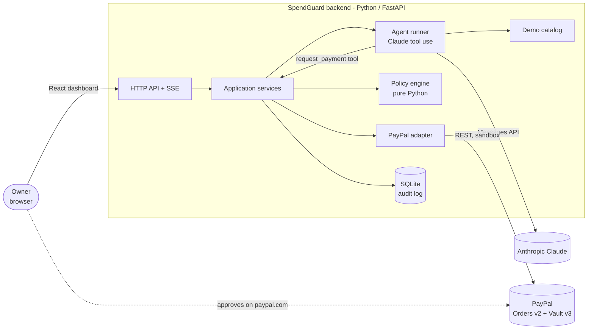
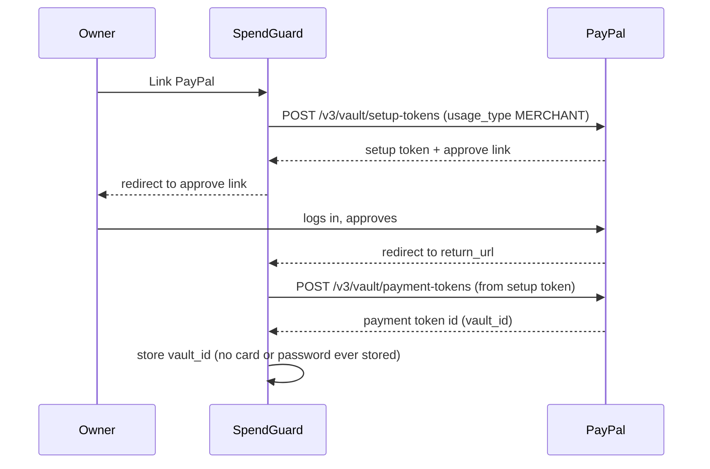
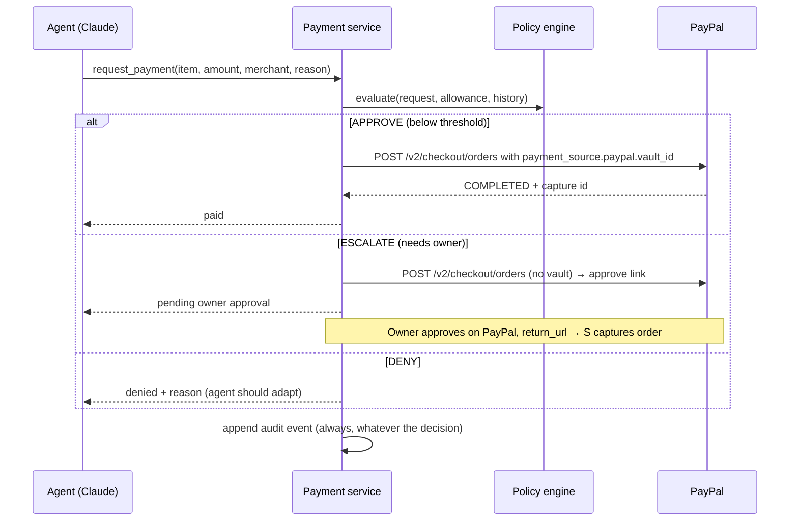

# SpendGuard — Architecture

## 1. The one rule

> **The agent proposes. Deterministic policy decides. PayPal executes.**

An LLM can be manipulated by any text it reads (prompt injection), so it must
never be the component that decides whether money moves. The agent can only
call a `request_payment` tool. That call goes to a plain Python policy engine
with no AI inside it. Only an `APPROVE` decision reaches PayPal.

## 2. System context



## 3. Layers (dependencies point inward)

```
api/        FastAPI routes, request/response schemas     ← outermost
services/   use cases: link wallet, run task, pay, refund
adapters/   paypal/, llm/, store/ (talk to the outside world)
domain/     Money, Allowance, PaymentRequest, Policy, Decision  ← innermost, no I/O
```

- `domain/` imports nothing from the other folders. It can be unit-tested in
  milliseconds with no network, no keys and no database.
- `services/` coordinates domain + adapters. It is the only place that says
  "check policy, then call PayPal, then write the audit log".
- `adapters/` are replaceable. Swapping Claude for another model, or SQLite for
  Postgres, touches one folder.
- `api/` only translates HTTP to service calls.

## 4. Key flows

### 4.1 Link wallet (once) — PayPal Vault v3



### 4.2 Agent purchase



## 5. Decisions (ADR summary)

| # | Decision | Why | Trade-off |
|---|---|---|---|
| ADR-1 | Policy engine is deterministic Python, outside the LLM | Prompt injection cannot change rules; rules are unit-testable | Rules are less "smart"; that is the point |
| ADR-2 | Vault payment token for automatic payments; normal Order + approve link for escalations | Agent can pay unattended within limits; PayPal's own page is the human checkpoint for big ones | Vault must be enabled on the sandbox app |
| ADR-3 | Money is `Decimal` + ISO currency, never `float` | `0.1 + 0.2 != 0.3` in floats; money bugs are unacceptable | Slightly more verbose |
| ADR-4 | Every PayPal write sends a `PayPal-Request-Id` | Idempotency: a retried request never charges twice | We must generate and store the id |
| ADR-5 | Audit log is append-only | An audit trail you can edit is not an audit trail | Corrections are new events |
| ADR-6 | Python 3.13 + FastAPI + httpx + Pydantic, SQLite, React (Vite, JavaScript) | Fast to build solo; async fits streaming agent steps; no DB server for judges | SQLite is single-node (fine for a demo) |
| ADR-7 | Claude via Anthropic SDK with tool use | Strong tool calling and reasoning; agent loop stays in our code so policy is enforced server-side | Needs an API key; model is configurable |
| ADR-8 | Local demo catalog (JSON) with one malicious listing | Reliable demo, injection test is reproducible | Not real products (Channel3 could be added later) |

## 6. Security notes

- Secrets live only in `backend/.env` (git-ignored). `.env.example` documents names.
- Sandbox only. The PayPal base URL is config, defaulting to `api-m.sandbox.paypal.com`.
- The agent never sees PayPal tokens or IDs it could misuse; it gets tool results only.
- Catalog text is treated as untrusted data; the system prompt says so, but the
  real protection is ADR-1.
